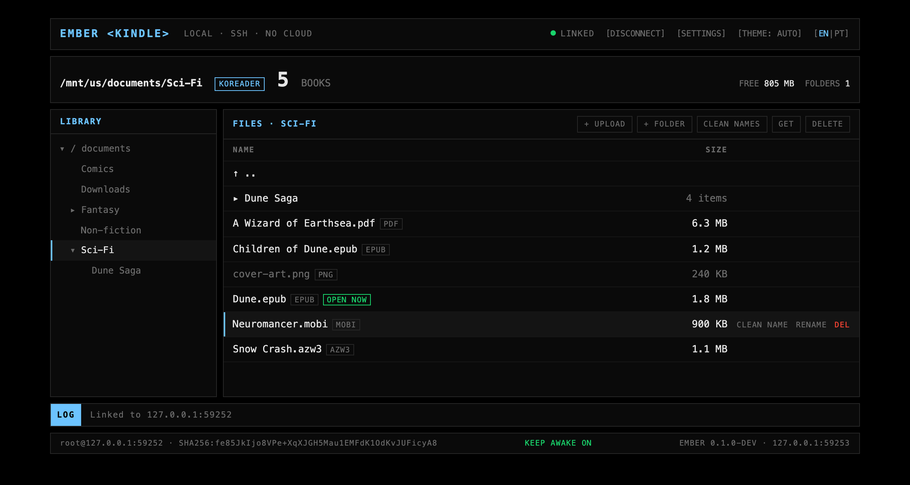
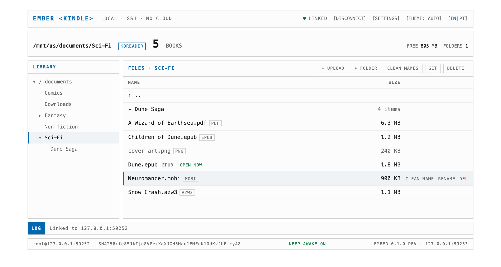
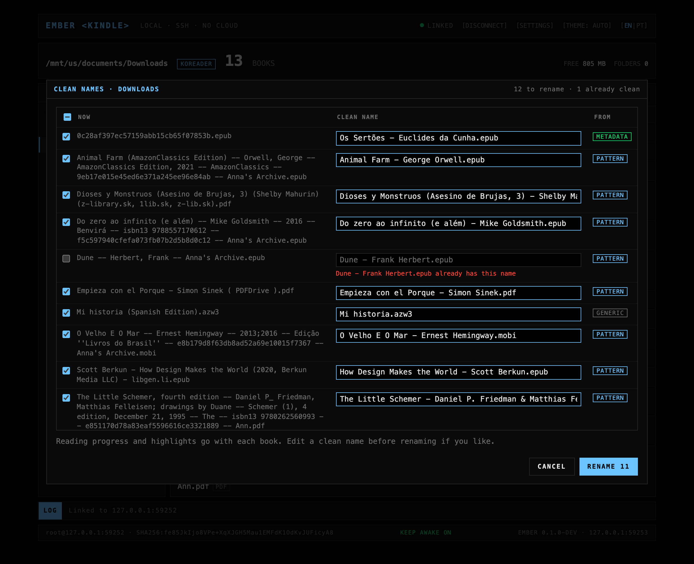
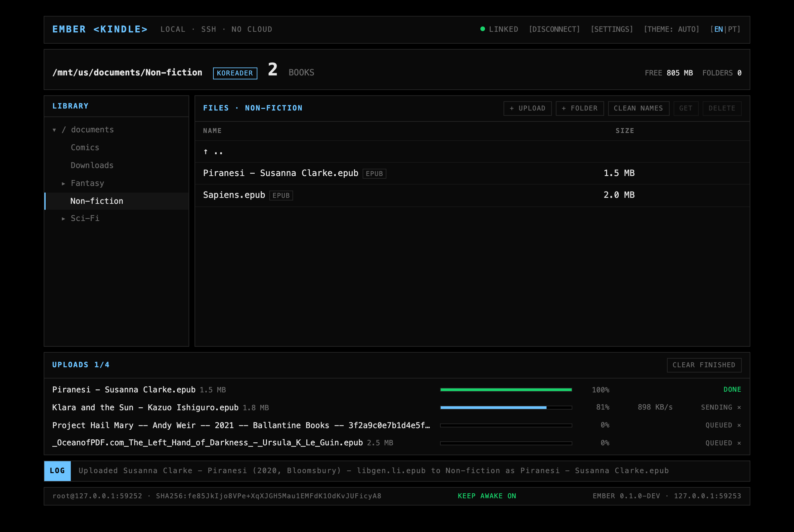
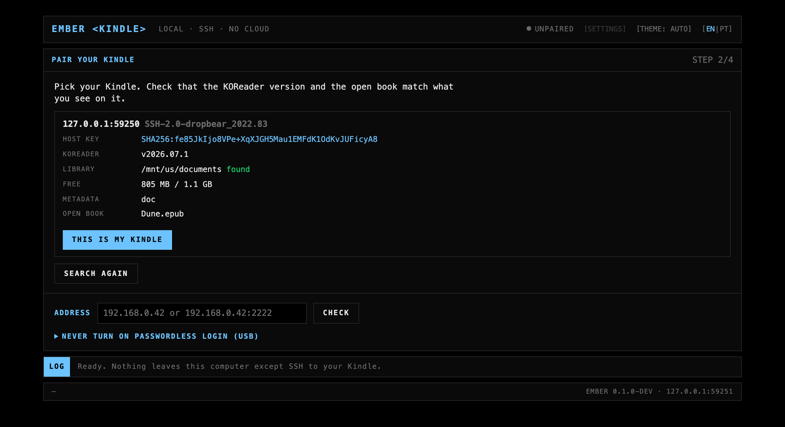
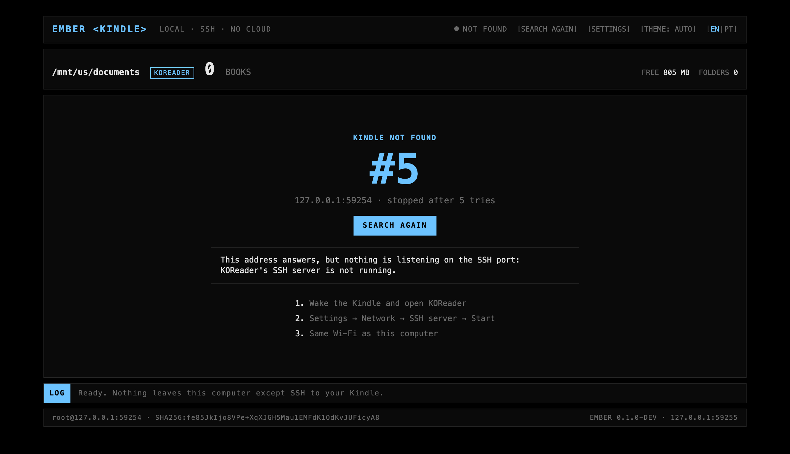
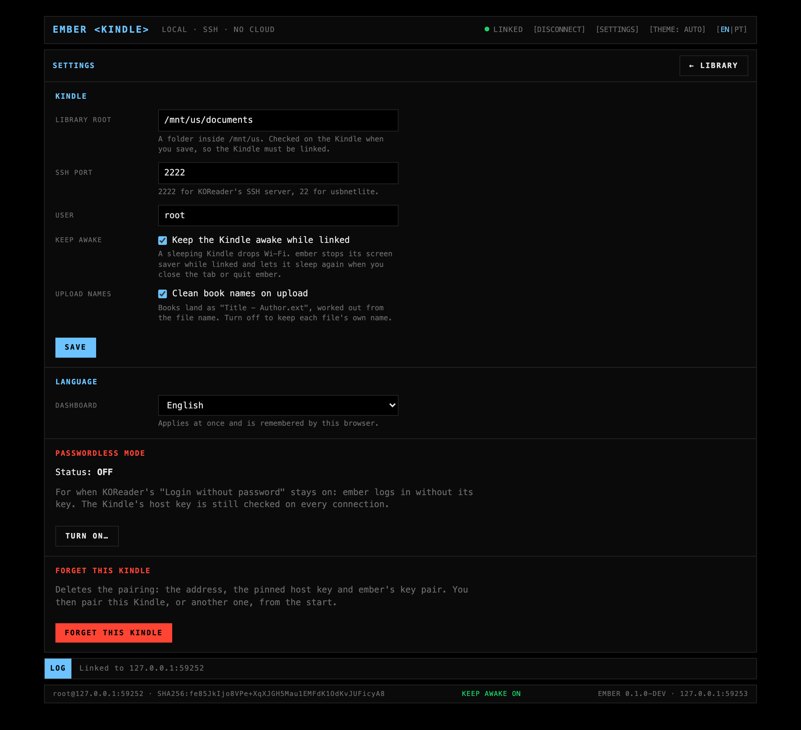
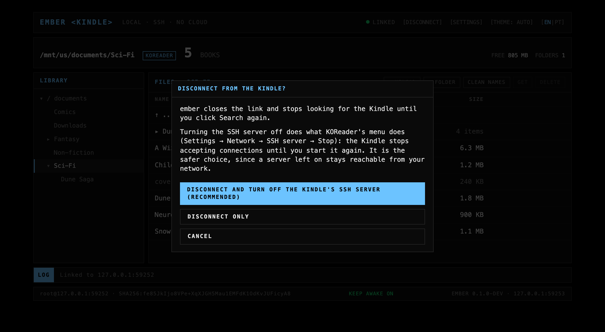

# ember

ember is a small web dashboard for managing the books on a jailbroken Kindle
running KOReader. You run it on your computer, it finds the Kindle on your Wi-Fi
and talks to it over SSH/SFTP, and you browse, upload, rename, move and delete
books from the browser. Everything stays on your local network: ember serves the
dashboard on `127.0.0.1` only, makes no requests to the internet and has no
account, cloud or telemetry.



## Screenshots



The same library in the light theme. The dashboard follows your system theme
until you pick one.



Clean names: a preview of `Title - Author.ext` for every book in a folder, with
where each name came from. Nothing is renamed until you apply it.



The upload queue, with progress per file. Book names are cleaned on the way in.



Pairing: ember found a Kindle and shows its host key, KOReader version and open
book so you can confirm it is yours.



When the Kindle does not answer, ember stops after five tries and waits for you
to click Search again.



Settings: library root, SSH port and user, keep-awake, upload names, language,
passwordless mode and forgetting the Kindle.



Disconnect, with the option to turn the Kindle's SSH server off as well.

## Features

- Folder tree and file list of the Kindle's library, with free space and the book
  KOReader has open flagged.
- Create, rename, move and delete books and folders. Moves and renames carry
  KOReader's `.sdr` sidecar, so reading progress and highlights stay with the book.
- Multi-file upload by button or drag and drop, with progress, cancel, and a
  Replace or Skip choice when a file is already there. Download any book back to
  the computer.
- Clean names: turns `Dune -- Herbert, Frank -- Anna's Archive.epub` into
  `Dune - Frank Herbert.epub`, using the metadata inside the book when it can.
- Finds the Kindle on its own, even after it gets a new address from the router.
- Keeps the Kindle awake while connected, so it does not drop Wi-Fi mid-upload.
- Can turn KOReader's SSH server off when you disconnect.
- Light and dark theme, English and Portuguese (Brazil).
- One binary, no installer, no background service. Runs on macOS, Linux and
  Windows.

## Requirements

- A Kindle that is [jailbroken](https://kindlemodding.org/jailbreaking/) and runs
  [KOReader](https://koreader.rocks). ember uses KOReader's built-in SSH server.
- Go 1.26 or newer to build it. Release binaries will come later.
- The computer and the Kindle on the same Wi-Fi network.

## Getting started

### Run ember

```sh
git clone https://github.com/odmrs/ember.git
cd ember
go run .
```

or build a binary once:

```sh
go build -o ember .
./ember
```

ember starts on `http://127.0.0.1:8737/` and opens it in your browser. Flags:

| Flag | Default | What it does |
| --- | --- | --- |
| `-port` | `8737` | Local port for the dashboard. `0` picks a free one. |
| `-no-open` | off | Do not open the browser on start. |
| `-config` | `ember` in your user config dir | Where ember keeps its profile and key pair. |

Stop it with Ctrl+C.

### Pair your Kindle (once)

ember logs in with its own key. To install that key, pairing uses KOReader's
"Login without password" option for a moment:

1. On the Kindle, open KOReader and connect to the same Wi-Fi as your computer.
2. Go to Settings (the gear) → Network → SSH server.
3. Tick "Login without password (DANGEROUS)".
4. Tap "SSH server" to start it.
5. In the dashboard, click Search the network. ember lists what it finds, with
   the host key fingerprint, KOReader version and the open book. Check them
   against your Kindle and click This is my Kindle. Nothing is written to the
   Kindle before that.
6. ember installs its key and tests a key-only login. Then, on the Kindle: tap
   "SSH server" to stop it, untick "Login without password (DANGEROUS)", and tap
   "SSH server" again to start it. The dashboard turns green when ember gets in
   with its key alone. Click Open library.

If you would rather never turn on passwordless login, open "Never turn on
passwordless login (USB)" on the pairing screen: connect the Kindle by USB, add
the key shown there to `koreader/settings/SSH/authorized_keys` (create the
folder and file if missing), eject, start the SSH server with "Login with key
only", and pick your Kindle in the dashboard. ember waits until the key works.

### Everyday use

1. On the Kindle: KOReader → Settings → Network → SSH server, and start it.
2. Run ember. It reconnects to your Kindle by itself. If the Kindle was asleep or
   the server was off, click Search again once it is up.
3. When you are done, click Disconnect. The dialog offers to turn the Kindle's
   SSH server off too, which is the safer choice: a server left on stays
   reachable from your network.

## Using it

- **Browse.** The tree on the left is the library root (`/mnt/us/documents` by
  default, changeable in Settings). Click a folder to open it; select files with
  click, Shift and Ctrl/Cmd.
- **Folders.** + Folder creates one in the folder you are in. Drag files or
  folders onto a folder in the list or the tree to move them.
- **Moves keep progress.** KOReader stores progress and highlights in a `.sdr`
  folder next to each book. ember moves, renames and deletes it together with the
  book, all or nothing. Nothing is ever overwritten: a name already taken at the
  destination is refused (ignoring case, as the Kindle does). The book KOReader
  has open asks for an extra confirmation.
- **Upload and download.** + Upload, or drop files on the file list. Files go to
  the open folder; ember checks the name and the free space first and writes to
  a temporary file that is renamed when complete. Get downloads the selected book.
- **Clean names.** Clean names on the toolbar (or Clean name on a row) proposes
  `Title - Author.ext` from the book's metadata (EPUB, MOBI/AZW3, PDF), from
  known download-site naming, or by stripping obvious noise. Names that already
  look clean are left alone and nothing is invented. You can edit each proposal
  or untick it before applying. Uploads get a clean name by default; turn that
  off in Settings → Upload names.
- **Theme.** The THEME button in the header cycles auto, light and dark.
- **Language.** EN | PT in the header, or Settings → Language.

## Privacy and security

- The dashboard listens on `127.0.0.1` only, so other machines cannot reach it.
- The dashboard makes no external requests: no CDN, fonts or analytics. A
  Content Security Policy blocks them and a test fails if a reference to an
  outside host appears.
- Two third-party Go modules, `golang.org/x/crypto` and `github.com/pkg/sftp`
  (plus what they need, `golang.org/x/sys` and `github.com/kr/fs`), pinned and
  vendored.
- ember logs in with its own ed25519 key and never stores or sends a password.
  The Kindle's host key is pinned at pairing; a host with a different key is
  refused, even at the right address.
- Passwordless mode, for people who keep "Login without password" on, is off by
  default, needs an explicit confirmation that explains the risk, and shows a
  warning banner while it is on.
- What ember does on the Kindle: reads and writes files under the library root
  over SFTP, runs `lipc-set-prop` to keep the screen saver off while connected,
  and, if you ask, stops KOReader's SSH server the same way KOReader's menu does.
  It logs in as root, because that is how KOReader's SSH server works.

## Known limitations

- KOReader's history and collections keep absolute paths, and ember does not
  rewrite them. A moved book drops out of KOReader collections and greys out in
  history (progress and highlights are kept).
- If KOReader keeps metadata in its own folder ("Book metadata location" set to
  `dir`), ember refuses to move or rename books, since their progress would be
  left behind. The default `doc` mode and `hash` mode work.
- Keep-awake needs `lipc-set-prop` on the Kindle. Without it ember shows
  "keep-awake unavailable" and carries on.
- ember cannot start KOReader's SSH server; you start it on the Kindle.
- Tested on a basic Kindle with KOReader v2025.08. Other models and versions
  should work but have not been tried.

## Contributing

Help is welcome, especially:

- **Bug reports.** Include what you did, what happened, the terminal output of
  ember and a screenshot if it is visual, plus your Kindle model, firmware
  version and KOReader version.
- **Testing on other Kindles.** Reports from models other than the basic Kindle,
  working or not, are useful on their own.
- **Translations.** The dashboard strings live in
  `internal/web/static/i18n/` (`en.json`, `pt.json`). A test checks that every
  catalog has the same keys and that every key the code uses exists.
- **Name cleaner corpus.** If ember cleans a real file name badly, add the name
  and the result you expect to the table in `internal/names/corpus_test.go`.

Development:

```sh
go test -race ./...
go vet ./...
gofmt -l .
```

The tests run against an in-process fake Kindle, so you do not need a device.

Some rules the project keeps:

- No new dependencies without an ADR in `docs/adr/`.
- The dashboard makes no external requests; tests enforce it.
- Small, focused pull requests, with tests.
- Code comments explain the code.

Design decisions and their reasons are in [`docs/adr/`](docs/adr/).

## License

License: to be decided.
