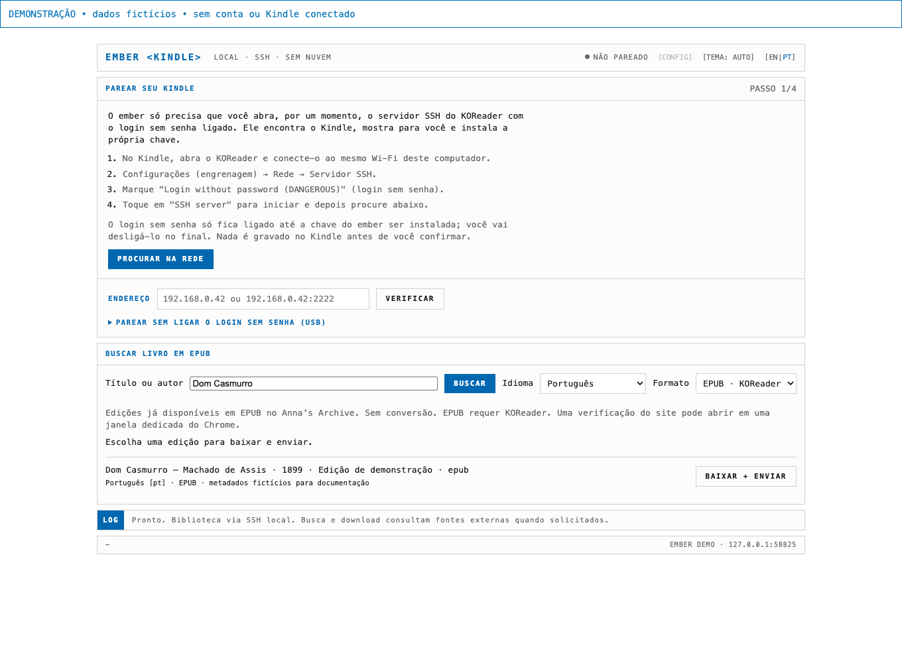
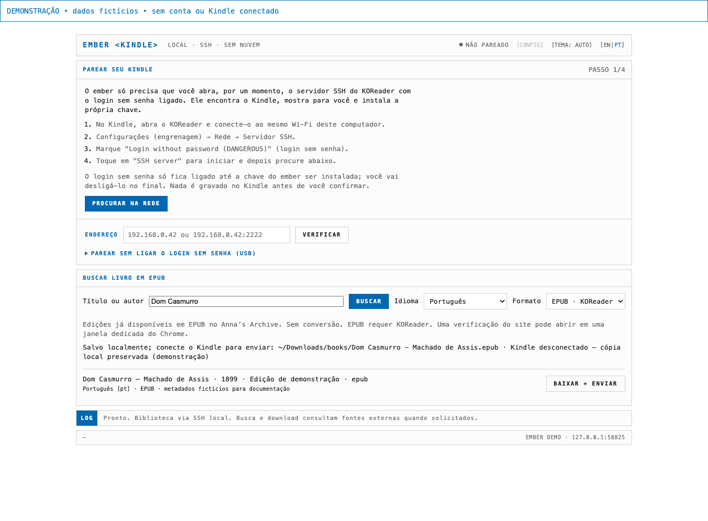

# Buscar um EPUB e enviar ao Kindle

O Ember permite pesquisar por título ou autor, escolher o idioma e uma edição,
baixar o EPUB existente, verificar o arquivo e enviá-lo pelo SSH do KOReader.
Uma cópia fica em `~/Downloads/books/`. Esse fluxo não converte o livro e não
precisa do Calibre.

> As imagens abaixo usam a interface real com respostas locais de demonstração.
> Não mostram uma conta, download real, biblioteca pessoal ou Kindle conectado.
> A disponibilidade de uma edição depende do catálogo e não é garantida.



## O que você precisa

- Go 1.26 ou mais recente para compilar o Ember e o helper `bookget`.
- Google Chrome já instalado em `/Applications/Google Chrome.app` para o fluxo
  de navegador. O helper atual implementa essa etapa no macOS; não há suporte
  equivalente de navegador para Windows ou Linux nesta versão.
- Para enviar: Kindle com jailbreak, KOReader e servidor SSH, na mesma rede
  do computador. O pareamento usa o fluxo normal do Ember.
- Acesso ao arquivo na fonte. Use livros em domínio público ou que você tenha
  autorização para obter. O programa não determina a situação autoral da obra.

O catálogo é uma função opcional: o gerenciamento da biblioteca por SSH continua
local. A busca e o download consultam serviços externos quando você os solicita.
Não há sincronização de biblioteca com uma nuvem do Ember.

## Instalar a versão com catálogo

Enquanto esta mudança estiver em revisão, use a branch indicada abaixo.
A versão `main` pode ainda não incluir a integração.

```sh
git clone --branch feat/verified-epub-catalog https://github.com/odmrs/ember.git
cd ember
(cd tools/bookget && go build -o ../../bookget ./cmd/bookget)
go build -o ember .
./ember
```

Abra `http://127.0.0.1:8737/`. Os dois executáveis devem ficar juntos.
Se preferir `go run .`, informe o caminho do helper:

```sh
BOOKGET_BIN="$PWD/bookget" go run .
```

No macOS, `scripts/macos-app.sh` compila e coloca os dois executáveis no aplicativo
Ember em `~/Applications`. Não é necessário instalar o Go no Kindle.
Para parear o aparelho, siga [Pair your Kindle](../README.md#pair-your-kindle-once).

## Configurar conta sem expor a chave

Uma conta registrada e uma assinatura paga são coisas diferentes. A integração
usa a opção gratuita de download lento quando a fonte a disponibiliza; registrar
uma conta não libera links pagos.

No macOS, o helper procura uma senha genérica nas Chaves do macOS (Keychain):

| Campo | Valor |
| --- | --- |
| Nome do item / serviço | `bookget.annas-archive` |
| Conta | `bookget` |
| Senha | A chave secreta da sua própria conta na fonte |

Crie o item no aplicativo Acesso às Chaves e preencha a senha ali. Não cole a
chave num comando, issue, README, captura de tela ou arquivo do repositório.
Se as Chaves pedirem autorização de acesso, verifique qual executável está
pedindo antes de autorizar. O helper não armazena a chave no painel do Ember.

`ANNAS_ARCHIVE_KEY` permite uma configuração explícita por variável de ambiente,
mas o ambiente pode ser lido por processos com acesso suficiente à sua conta.
Não salve uma chave em scripts, perfis de shell ou configurações versionadas.

O domínio da fonte pode ser definido por `BOOKGET_ANNA_URL` (origem HTTPS exata)
ou pelo campo `anna_url` em `~/Library/Application Support/bookget/config.json`.
Sem configuração explícita, o helper tenta descobrir as origens na infobox da
Wikipedia. Essa descoberta depende da disponibilidade e integridade da página;
não é uma validação independente da reputação do site. Nunca use um domínio
recebido de um anúncio ou vendedor desconhecido.

## Buscar, escolher e enviar

1. Abra o Ember e localize **Encontrar um livro em EPUB**.
2. Digite somente o título ou autor, por exemplo `Dom Casmurro`.
3. Em **Idioma**, escolha **Português** (padrão), inglês, espanhol, francês,
   alemão, italiano, japonês ou **Todos os idiomas**. Esse seletor escolhe o
   idioma do livro; EN/PT no cabeçalho escolhe o idioma do painel.
4. Clique **Buscar**. Alterar o idioma exige uma nova busca.
5. Compare título, autor, editora, ano e detalhes das edições retornadas.
6. Clique **Baixar + enviar** na edição desejada.
7. Se abrir uma janela dedicada do Chrome, conclua a verificação normal do site
   e aguarde. O Ember mostra o progresso e retoma quando houver um link válido.
8. Confira a mensagem final: ela diferencia arquivo salvo de envio confirmado.

O filtro de idioma vai para a consulta do catálogo e é reaplicado aos metadados
recebidos. Uma edição com idioma desconhecido não aparece quando há um filtro.
`pt-BR` é aceito como português nos metadados. O idioma não é deduzido do texto
que você digitar; não é preciso acrescentar “português” ao título.
Metadados fornecidos pela fonte podem estar errados: confirme a edição.

### Onde fica a cópia

No Finder, abra Downloads → books. O nome vem dos campos de título e autor
internos do EPUB, com caracteres de caminho removidos:

```text
~/Downloads/books/Dom Casmurro - Machado de Assis.epub
```



Se o Kindle estiver offline, o arquivo verificado fica salvo e o Ember informa
que ele não foi enviado. Você pode enviá-lo depois pelo upload normal da biblioteca.
Uma mensagem de erro de upload pode coexistir com uma cópia local concluída;
confira o caminho exibido. O envio bem-sucedido confirma o upload, não abre o
livro automaticamente no leitor.

Se já existir uma cópia local idêntica, o helper compara o SHA-256 e a reutiliza.
Um arquivo diferente com o mesmo nome é preservado e a operação é recusada.
No Kindle, colisões de nome também são recusadas nesse fluxo.

## Usar o CLI em outro projeto

```sh
./bookget search "Dom Casmurro" --language pt
./bookget search "Dom Casmurro" --language pt --json
./bookget get 1 --format epub
./bookget get 1 --format epub --send
./bookget get 1 --out "$HOME/Downloads/books"
```

Sem `--language`, o CLI pesquisa todos os idiomas. A saída JSON vai para stdout;
progresso e erros vão para stderr. Uma nova busca substitui a numeração local.
Para integrações, guarde o `ID` completo do resultado (`anna:<md5>`), não o número.
O MD5 do ID identifica o registro do catálogo; não é uma assinatura de segurança.
O helper calcula SHA-256 quando consulta o VirusTotal ou compara arquivos locais.

Execute o CLI com uma lista de argumentos, sem concatenar título ou ID em um
comando de shell. Códigos de idioma devem ter duas ou três letras minúsculas.
O dashboard usa tokens de seleção de 30 minutos e não aceita URLs de download
arbitrárias no endpoint de aquisição. Uma operação de catálogo acontece por vez.

As rotas locais usadas pelo painel são:

| Rota | Uso |
| --- | --- |
| `GET /api/books/search?q=...&language=pt` | Busca e retorna edições com tokens de seleção |
| `GET /api/books/status` | Progresso da operação em andamento |
| `POST /api/books/get` | JSON com `token` e `format: "epub"`; baixa e tenta enviar |

As proteções de Host e Origin do Ember continuam valendo. A API é local, não
um serviço público com autenticação multiusuário: não publique a porta por proxy,
túnel ou encaminhamento do roteador.

## Verificações e limites

Antes de publicar o arquivo final ou enviá-lo ao Kindle, o helper verifica:

- Download HTTPS, origem explícita, redirecionamentos restritos e até 200 MiB.
  No download do navegador, o host é obtido da fonte e os endereços DNS são
  verificados no momento da conexão para recusar endereços privados/reservados.
- Assinatura ZIP, `mimetype` exato de EPUB, CRC, container e OPF.
- Caminhos absolutos ou com `..`, entradas duplicadas, links simbólicos e
  extensões executáveis conhecidas.
- Mais de 10.000 entradas ou descompressão total acima de 10 vezes o tamanho ZIP.
- Scripts e atributos ativos conhecidos nos arquivos XHTML/HTML/SVG inspecionados.

Os achados bloqueiam a publicação. O arquivo baixa primeiro para um diretório
temporário privado e só recebe o nome final após aprovação. Cancelamentos normais
e erros limpam esse diretório; encerramentos abruptos do sistema podem deixar
uma pasta oculta `.bookget-*` em Downloads/books.

Esses controles são defesa adicional, não um antivírus completo nem uma sandbox.
Não há garantia de detectar toda forma de conteúdo ativo, referências externas,
malware, falhas de fontes/imagens ou vulnerabilidades do Chrome/KOReader. Mantenha
os programas atualizados. Um EPUB legítimo também pode ser recusado por limites
conservadores de tamanho, XML ou compressão. O fluxo padrão aceita EPUB existente;
as verificações legadas de PDF/AZW3 são mais limitadas e não equivalem às de EPUB.

### VirusTotal opcional

`VT_API_KEY` habilita somente uma consulta HTTPS pelo SHA-256 em
`GET /api/v3/files/{sha256}`. O arquivo não é enviado e não há pedido de rescan.
O hash, seu IP e a autenticação da API ficam visíveis ao VirusTotal.
“Unknown to VT” é neutro. Uma detecção maliciosa ou erro da API bloqueia a
publicação quando essa função está habilitada. Sem chave, essa etapa não roda.
Uma resposta sem detecções não comprova que o arquivo é seguro.

## Dados locais e privacidade

| Dado | Onde fica / quem recebe |
| --- | --- |
| Chave de conta | Keychain no macOS; usada para autenticar na fonte |
| Sessão do navegador | Perfil separado em `~/Library/Application Support/bookget/browser/` |
| Última busca do CLI | `~/Library/Caches/bookget/search.json` no macOS, com metadados e URLs da fonte |
| Livro concluído | `~/Downloads/books/`, ou `--out` |
| Perfil e chave SSH do Ember | Diretório de configuração do Ember, separado do bookget |
| Título, IP e sessão da fonte | Visíveis aos serviços consultados; HTTPS não oculta isso do destino |

O Chrome dedicado usa pipes DevTools herdados, sem porta de depuração TCP.
Esse perfil separado não é uma sandbox de sistema operacional e suas sessões
são dados sensíveis. Ele não usa o perfil pessoal do navegador.

O projeto público não deve conter credenciais, cookies, perfis, livros baixados,
logs de navegação, relatórios locais ou caminhos pessoais. Compartilhe somente
um relato mínimo e revisado ao reportar problemas. Nunca envie o perfil do Chrome
nem a pasta de configuração do Ember para uma issue.

## Se algo der errado

| Situação | O que fazer |
| --- | --- |
| `bookget is missing` | Compile o helper e deixe-o ao lado do binário Ember, ou configure `BOOKGET_BIN`. |
| HTTP 403 / verificação | Confira a janela dedicada do Chrome. Não há solução automática de CAPTCHA. |
| Busca expirada | A busca pode usar até quatro minutos; no painel há limite externo de cinco. Conclua a verificação e repita. |
| Download lento expirado | A resolução do link espera até oito minutos. Filas ou indisponibilidade da fonte podem impedir a operação. |
| `another book operation is running` | Aguarde a operação atual terminar. Fechar/atualizar a aba pode cancelar a requisição. |
| Nenhum resultado em português | Revise o título; tente Todos os idiomas para conferir a classificação da fonte. |
| EPUB recusado | Leia o motivo. Não desative as verificações para enviar o mesmo arquivo. |
| Kindle não vinculado | A cópia local é mantida. Confira Wi-Fi, SSH, pareamento e a chave do aparelho. |
| Mesmo nome, conteúdo diferente | Renomeie ou mova a cópia que você quer preservar antes de repetir. |
| VirusTotal indisponível | A etapa habilitada falha de forma fechada. Aguarde a API e repita. |

O programa não instala Chrome ou Calibre, não contorna CAPTCHA ou assinatura e
não garante disponibilidade do catálogo externo. O recebimento físico pelo
Kindle deve ser verificado no seu aparelho; testes automatizados usam um servidor
local simulado.

## Remover configuração ou voltar à versão anterior

Feche o Ember e sua janela dedicada do Chrome antes de fazer alterações.
Para desabilitar a busca, remova o binário `bookget` de junto do Ember e desfaça
`BOOKGET_BIN` se definido; a biblioteca local continua independente do helper.
Para voltar à versão anterior, guarde os binários atuais e compile o commit
anterior em outra pasta, sem apagar sua configuração de pareamento.

Se quiser apagar dados do catálogo, use Finder e Acesso às Chaves para remover,
respectivamente, o perfil `bookget/browser`, o cache `bookget/search.json`, o
arquivo opcional `bookget/config.json` e o item `bookget.annas-archive` do Keychain.
Isso encerra a sessão do catálogo; não apaga os livros em Downloads/books.
Não apague o perfil do Ember se quiser manter o pareamento SSH.
Se uma chave foi exposta, substitua-a/revogue-a na fonte; apagá-la localmente não
revoga a cópia exposta.

## Validar sem rede nem Kindle

```sh
go test -race ./...
go vet ./...
node --test internal/web/bookget_ui_test.cjs
(cd tools/bookget && go test -race ./... && go vet ./... && golangci-lint run ./...)
```

Os testes de catálogo usam fontes HTTPS, respostas de navegador, VirusTotal e
upload locais simulados. A geração dos prints também é local e tem dados
fictícios: veja `scripts/catalog-screenshots.py`. Isso não comprova a
disponibilidade de um download real nem a conexão a um Kindle físico.

Para a análise das fronteiras de confiança, veja [Segurança do catálogo](bookget-security.md).
Vulnerabilidades devem ser relatadas conforme [SECURITY.md](../SECURITY.md).
